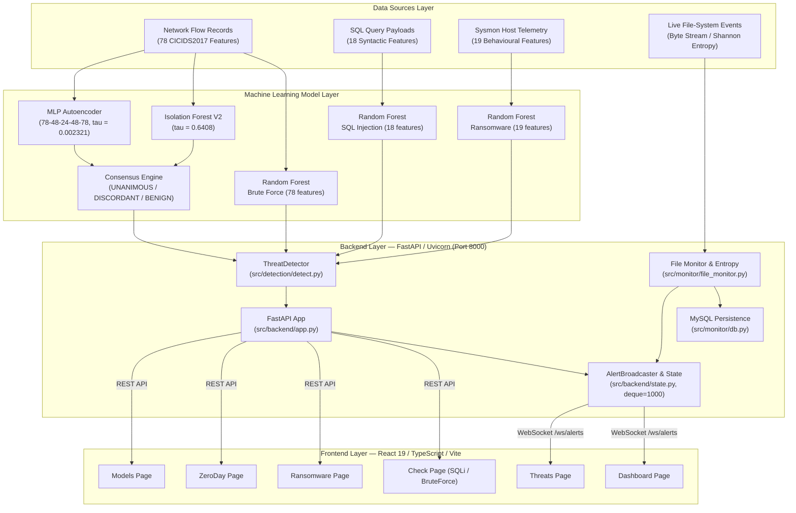
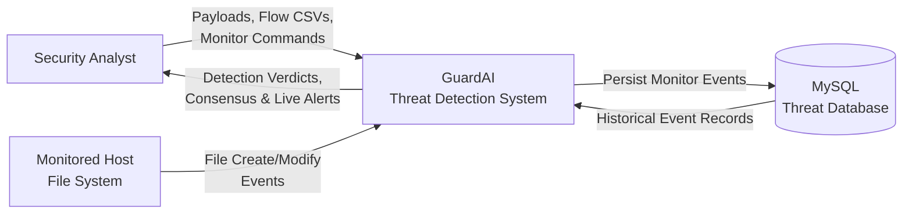
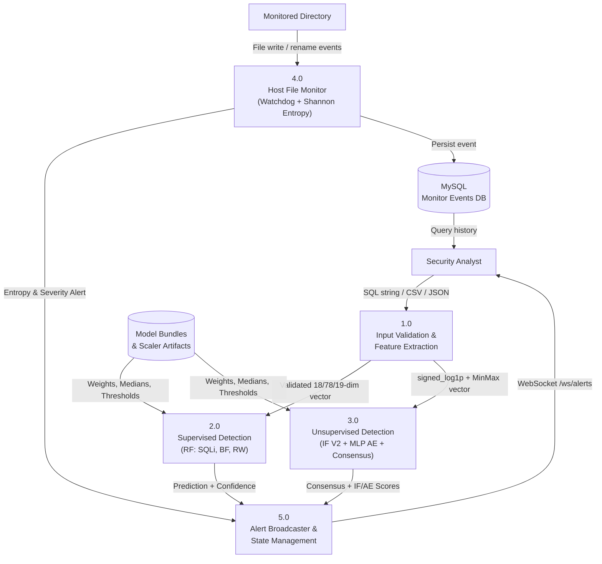
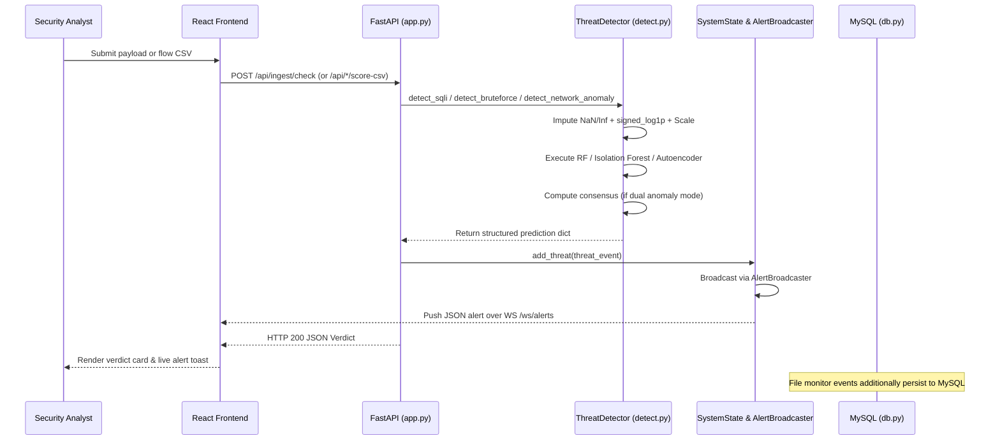
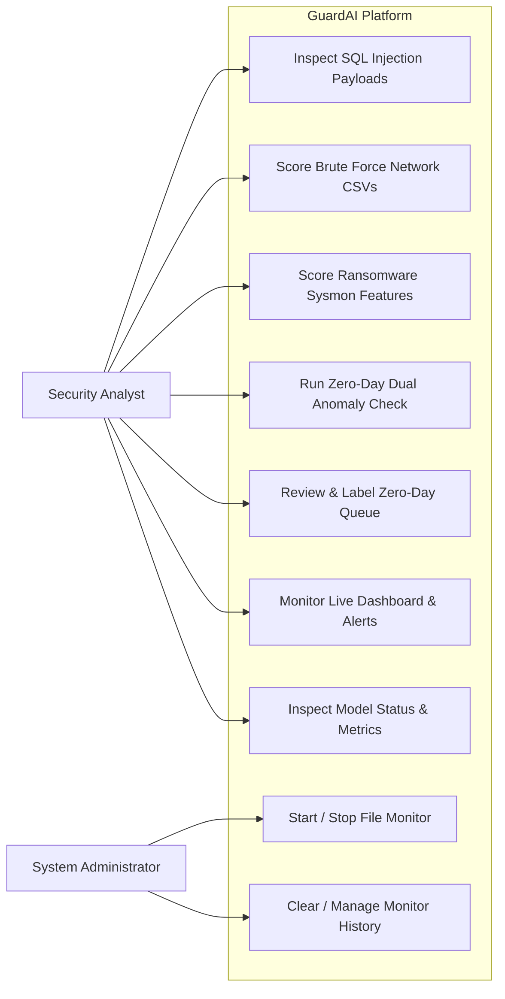
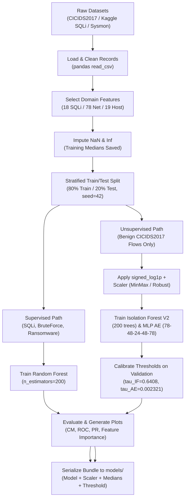
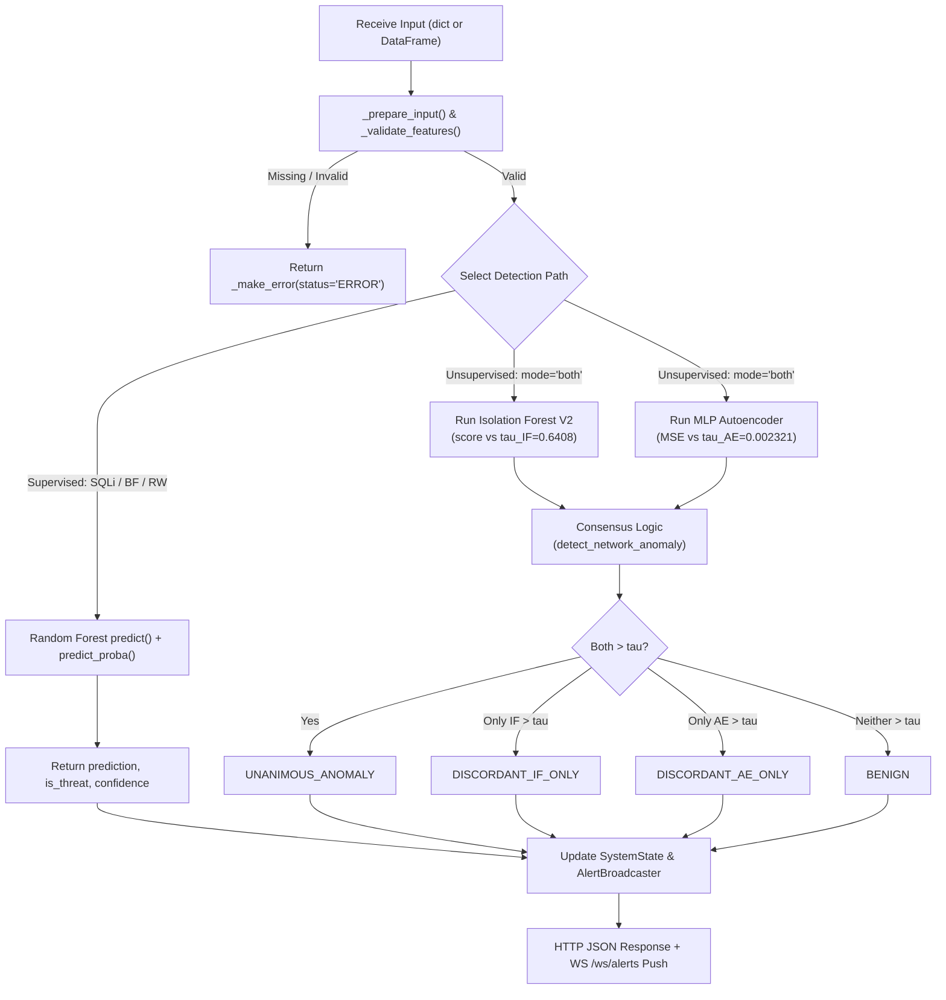

# AI-Based Cyber Threat Detection

---

**School of Engineering and Technology**

**Project Report**

Submitted in partial fulfilment of the requirements for the degree of  
**Bachelor of Engineering / Bachelor of Technology**  
(Computer Engineering / Information Technology)

**Academic Year:** 2026–27

---

| Sr. No. | Student Name | Roll No. / Enrolment No. |
|---------|-------------|--------------------------|
| 1 | Sakshi Sanjay Pawar | 41 |
| 2 | Vaishnavi Vinod More | 35 |
| 3 | Rutuja Ashok Mohite | 33 |
| 4 | Shantanu Keraba Patil | 42 |

**Guide / Supervisor:** Dr. C. J. Awati  
**College / University:** School of Engineering and Technology  
**Academic Year:** 2026–27

[Insert Screenshot: Title page as formatted for official submission]

---

## INDEX

| Section | Title | Page |
|---------|-------|------|
| — | Abstract | 6 |
| Chapter 1 | Introduction | 7 |
| Chapter 2 | Literature Review | 9 |
| 2.1 | Research Gaps | 12 |
| 2.2 | Problem Statement | 12 |
| 2.3 | Objectives | 12 |
| Chapter 3 | Proposed System | 13 |
| 3.1 | System Architecture | 14 |
| 3.2 | Software and Hardware Requirements | 15 |
| 3.3 | System Design | 16 |
| Chapter 4 | Implementation | 21 |
| 4.1 | Port Scanning | 22 |
| 4.2 | Simplified Vulnerability Scanning | 22 |
| 4.3 | Port Checking | 23 |
| 4.4 | Taking Inputs | 25 |
| 4.5 | Result | 26 |
| Chapter 5 | Results and Analysis | 27 |
| 5.1 | Detection | 30 |
| Chapter 6 | Conclusion | 32 |
| — | References | — |

---

## LIST OF FIGURES

| Figure No. | Caption |
|------------|---------|
| Fig 3.1 | High-Level System Architecture of GuardAI |
| Fig 3.2 | Level-0 Data Flow Diagram (Context Diagram) |
| Fig 3.3 | Level-1 Data Flow Diagram |
| Fig 3.4 | Sequence Diagram — Detection Request Lifecycle |
| Fig 3.5 | Use Case Diagram |
| Fig 3.6 | ML Training Pipeline Flowchart |
| Fig 4.1 | Flowchart of the Detection Engine Request Handling |
| Fig 5.1 | SQL Injection — Performance Metrics Bar Chart |
| Fig 5.2 | SQL Injection — Confusion Matrix |
| Fig 5.3 | SQL Injection — ROC Curve |
| Fig 5.4 | SQL Injection — Precision-Recall Curve |
| Fig 5.5 | SQL Injection — Feature Importance |
| Fig 5.6 | Brute Force — Performance Metrics Bar Chart |
| Fig 5.7 | Brute Force — Confusion Matrix |
| Fig 5.8 | Brute Force — ROC Curve |
| Fig 5.9 | Brute Force — Precision-Recall Curve |
| Fig 5.10 | Brute Force — Feature Importance |
| Fig 5.11 | Ransomware — Performance Metrics Bar Chart |
| Fig 5.12 | Ransomware — Confusion Matrix |
| Fig 5.13 | Ransomware — ROC Curve |
| Fig 5.14 | Ransomware — Precision-Recall Curve |
| Fig 5.15 | Ransomware — Feature Importance |
| Fig 5.16 | Anomaly Detection — Performance Metrics Bar Chart |
| Fig 5.17 | Anomaly Detection — Confusion Matrix |
| Fig 5.18 | Anomaly Detection — ROC Curve |
| Fig 5.19 | Anomaly Detection — Precision-Recall Curve |
| Fig 5.20 | Anomaly Detection — Anomaly Score Distribution |

---

## LIST OF TABLES

| Table No. | Caption |
|-----------|---------|
| Table 3.1 | Software Requirements |
| Table 3.2 | Hardware Requirements |
| Table 3.3 | Machine Learning Model Parameters |
| Table 3.4 | REST API and WebSocket Endpoint Summary |
| Table 4.1 | Dataset Summary Across GuardAI Detection Modules |
| Table 5.1 | SQL Injection — Classification Metrics |
| Table 5.2 | Brute Force — Classification Metrics |
| Table 5.3 | Ransomware — Classification Metrics |
| Table 5.4 | Anomaly Detection — Per-Attack Metrics (Isolation Forest V2) |
| Table 5.5 | Anomaly Detection — Per-Attack Metrics (MLP Autoencoder) |
| Table 5.6 | Comparative Performance Across All GuardAI Models |
| Table 6.1 | Functional Test Cases (`tests/test_detection_engine.py`) |

---

## ABSTRACT

Modern enterprise and web-facing infrastructures face a continuously evolving spectrum of cyber threats spanning application-layer exploitation, automated credential attacks, destructive host-level malware, and previously unseen zero-day network intrusions. Traditional signature-based intrusion detection systems rely on predefined attack patterns and static rules, leaving organizations vulnerable to polymorphic payloads, obfuscated queries, and novel attack vectors. Furthermore, existing machine learning security tools typically operate in isolation, targeting a single threat domain without offering unified operational visibility, real-time alerting, or coordinated anomaly consensus. To address these limitations, this project presents **GuardAI**, an AI-based cyber threat detection full-stack web platform developed at the School of Engineering and Technology during the 2026–27 academic year.

GuardAI integrates five specialized machine learning models within a unified detection architecture backed by a FastAPI 0.115+ service running on Uvicorn 0.54.0 and Python 3.11 on port 8000, paired with a responsive six-page frontend built using React 19, TypeScript, Vite, and SCSS (`dashboard`, `check`, `ransomware`, `zeroday`, `models`, and `threats`). Three supervised Random Forest (RF) classifiers (`n_estimators=200`) handle known threat categories: SQL Injection detection trained on the Kaggle SQLi corpus using 18 syntactic features with balanced class weights; Brute Force detection trained on 78 network flow features from the CICIDS2017 dataset; and Ransomware detection trained on 19 behavioral features extracted from Windows Sysmon ransomware and goodware logs. Data preparation incorporates `signed_log1p` transformation, `MinMaxScaler(0,1)` normalization, median imputation, and stratified 80/20 train-test splitting. To identify zero-day network anomalies without prior attack labels, GuardAI employs an unsupervised dual-model pipeline trained exclusively on benign CICIDS2017 flows, combining Isolation Forest V2 (200 trees, `RobustScaler`, threshold $\tau = 0.6408$) with a Multi-Layer Perceptron (MLP) Autoencoder (`MLPRegressor`, $78 \rightarrow 48 \rightarrow 24 \rightarrow 48 \rightarrow 78$, ReLU, Adam, batch size 256, `max_iter=30`, threshold $\tau = 0.002321$). A four-state dual-model consensus mechanism categorizes traffic into `UNANIMOUS_ANOMALY`, `DISCORDANT_IF_ONLY`, `DISCORDANT_AE_ONLY`, and `BENIGN`, balancing sensitivity and specificity across disparate anomaly geometries. At the host layer, a Watchdog `PollingObserver` computes Shannon entropy on file-write events to provide early ransomware warning, while alerts are streamed via a thread-safe `AlertBroadcaster` over the `/ws/alerts` WebSocket, buffered in a 1000-entry in-memory `deque`, and persisted in MySQL via `db.py`.

Experimental evaluation demonstrates strong predictive performance across all supervised and unsupervised detection pipelines. The SQL Injection Random Forest achieves an accuracy of 0.996 and an Area Under the ROC Curve (AUC) of 1.000, while the Brute Force Random Forest attains an accuracy of 1.000 and an AUC of 0.9998. On Windows Sysmon telemetry, the Ransomware Random Forest records an accuracy of 0.987 and an AUC of 0.998. In the unsupervised zero-day evaluation, Isolation Forest V2 achieves an overall AUC of 0.6797, whereas the MLP Autoencoder improves detection sensitivity on stealthy infiltration traffic, raising infiltration recall to 0.611. Together with real-time entropy-based file monitoring and structured MySQL persistence, these results confirm that GuardAI delivers an accurate, extensible, and operationally cohesive multi-domain threat detection platform.

---

## CHAPTER 1: INTRODUCTION

### 1.1 Background and Context

The rapid expansion of cloud computing, web-facing enterprise services, and distributed digital infrastructures has substantially widened the modern cyber attack surface. Organizations across financial, healthcare, educational, and public sectors routinely expose application programming interfaces (APIs), authentication portals, and shared file repositories to external networks, creating high-value targets for adversaries. Over the past decade, cybercrime has evolved from isolated, opportunistic probing into highly automated, persistent, and economically destructive operations. Beyond direct financial extortion, intellectual property theft, and unauthorized database exfiltration, security breaches impose severe operational downtime, regulatory compliance penalties, incident-response overheads, and long-term reputational damage. As digital platforms become foundational to institutional continuity and everyday workflows, timely, accurate, and multi-layered threat detection has become an indispensable engineering requirement rather than a secondary safeguard.

Historically, organizational perimeter and application defenses have relied heavily on signature-based Intrusion Detection Systems (IDS) and rule-driven Web Application Firewalls (WAFs). While signature matching delivers deterministic precision and low computational latency for previously cataloged exploits, it suffers from an inherent structural lag because a detection rule can only be authored after an attack has been observed, reverse-engineered, and disseminated. Adversaries routinely evade static pattern matching through minor syntactic obfuscation in structured query payloads, distributed low-and-slow credential guessing, encrypted command-and-control traffic, and rapidly mutating malware binaries. Furthermore, maintaining ever-expanding rule repositories introduces significant administrative complexity, increases false alarms when generic rules overlap with legitimate traffic, and degrades throughput during high-volume inspection across network flows and endpoint logs.

In response to the rigidity of signature-based mechanisms, machine learning (ML) has emerged as a central paradigm in contemporary cybersecurity analytics. Supervised ensemble algorithms such as Random Forest learn discriminative combinations of syntactic, statistical, and behavioral features directly from labeled telemetry, enabling robust generalization against structural variants of known threats including SQL injection, network brute-force campaigns, and ransomware execution. Simultaneously, unsupervised anomaly detection techniques—including tree-based isolation forests and neural autoencoders—model the underlying statistical manifold of normal benign activity without requiring labeled examples of every emerging exploit. Bridging these complementary ML paradigms with real-time host monitoring, structured database auditing, and an accessible operational interface forms the foundational technical context of the GuardAI platform.

### 1.2 Motivation

The motivation for developing GuardAI stems from the persistent operational severity of four distinct yet interconnected threat vectors that dominate contemporary security incidents. First, ransomware has escalated into one of the most destructive threats targeting endpoint systems and institutional data repositories. Modern ransomware rapidly enumerates user directories, encrypts critical files using strong cryptographic algorithms, and alters process execution patterns in ways that produce observable anomalies in Windows Sysmon logs alongside sharp spikes in file-write Shannon entropy. Because cryptographic destruction becomes effectively irreversible within seconds once bulk encryption commences, early behavioral detection spanning both process-level telemetry and real-time filesystem write events is essential for timely containment before widespread data loss occurs.

Second, SQL injection (SQLi) remains firmly entrenched among the most dangerous web application vulnerabilities, consistently appearing on the OWASP Top Ten list despite longstanding industry awareness regarding parameterized queries and input validation. Legacy enterprise codebases, dynamically assembled database queries, and complex middleware parsers continue to expose backend relational databases to unauthorized data extraction, privilege escalation, and authentication bypass. Third, automated brute-force attacks against exposed login services and network ports remain pervasive due to widely accessible botnets and automated credential-stuffing frameworks. Because these attacks manifest through high-frequency connection attempts, abnormal inter-arrival timings, and skewed packet distributions within network flow telemetry such as the CICIDS2017 benchmark, automated flow-level classification is vital to separate legitimate traffic surges from sustained credential attacks.

Fourth, the continuous emergence of zero-day exploits and stealthy multi-stage infiltration techniques exposes the fundamental blind spot of purely supervised classifiers. Models trained exclusively on historical attack labels cannot reliably generalize to novel intrusion vectors whose traffic distributions diverge from training-time attack signatures. Unsupervised models trained solely on benign network flows—specifically Isolation Forest V2 and Multi-Layer Perceptron (MLP) Autoencoders—are therefore critical for recognizing previously unseen anomalous behaviors. Integrating high-precision supervised models for known threats, dual-model unsupervised consensus for zero-day anomalies, and host-level file-entropy monitoring within one cohesive full-stack web application directly motivates the design and engineering of GuardAI.

### 1.3 Problem Statement

Existing cyber threat detection solutions frequently suffer from severe architectural fragmentation and narrow single-domain detection scopes. Commercial and open-source security utilities commonly inspect only one telemetry layer at a time—for instance, scanning HTTP query strings solely for SQL injection, analyzing network flow records solely for brute-force activity, or auditing endpoint process logs solely for malware. Consequently, security analysts must correlate disparate alerts manually across disconnected interfaces, which increases response latency and creates visibility blind spots between upstream network anomalies and downstream host compromise. Moreover, standalone unsupervised anomaly detectors often generate excessive false-positive alerts when deployed without a secondary corroborating model, eroding operator confidence and inducing alert fatigue.

At the same time, numerous academic machine learning intrusion detection prototypes remain restricted to offline scripts and static evaluation notebooks, lacking a production-oriented backend API, real-time alert streaming, persistent audit storage, and a unified graphical interface. There is a clear operational need for an integrated full-stack platform that combines supervised Random Forest classifiers for SQL injection, brute-force, and ransomware detection with an unsupervised dual-model consensus pipeline for zero-day flows and live host file-entropy monitoring, all delivered through a cohesive web dashboard.

### 1.4 Objectives

The primary implementation objectives of the GuardAI project are defined as follows:

1. **Train Supervised Classifiers for Known Threat Domains:** Develop and train three Random Forest classifiers (`n_estimators=200`) targeting SQL Injection (18 syntactic features from the Kaggle SQLi corpus with balanced class weights), Brute Force (78 CICIDS2017 network flow features), and Ransomware (19 Windows Sysmon features). Each supervised classifier is engineered to achieve a minimum target accuracy of 95% and an Area Under the ROC Curve (AUC) of at least 0.95.
2. **Train Unsupervised Models for Zero-Day Anomaly Detection:** Construct and calibrate two complementary unsupervised models—Isolation Forest V2 (200 trees with `RobustScaler` and threshold $\tau = 0.6408$) and an MLP Autoencoder (`MLPRegressor`, $78 \rightarrow 48 \rightarrow 24 \rightarrow 48 \rightarrow 78$, ReLU, Adam, batch size 256, `max_iter=30`, threshold $\tau = 0.002321$)—exclusively on benign CICIDS2017 flows. Integrate their outputs through a dual-model consensus logic (`UNANIMOUS_ANOMALY`, `DISCORDANT_IF_ONLY`, `DISCORDANT_AE_ONLY`, and `BENIGN`) to surface novel network anomalies.
3. **Implement a High-Performance FastAPI Backend:** Build a modular RESTful backend service using FastAPI 0.115+, Uvicorn 0.54.0, and Python 3.11 running on port 8000 to serve real-time inference endpoints across all five ML models. Incorporate an in-memory bounded `deque` (maximum capacity 1000), a thread-safe `AlertBroadcaster`, and a `/ws/alerts` WebSocket endpoint for low-latency alert dissemination.
4. **Implement a Six-Page React 19 Frontend:** Design and develop a responsive web interface using React 19, TypeScript, Vite, and SCSS comprising six dedicated operational views: `dashboard`, `check`, `ransomware`, `zeroday`, `models`, and `threats`. Ensure seamless visualization of live alerts, interactive payload and flow inspection, consensus breakdowns, and model performance metrics.
5. **Implement Host-Level File Monitoring for Ransomware Early Warning:** Deploy a background filesystem monitor built on the Watchdog `PollingObserver` to track file-write events in real time. Compute Shannon entropy on modified files to identify abnormal encryption-like randomness spikes and trigger immediate host-level ransomware alerts.
6. **Conduct Comprehensive Model Evaluation:** Evaluate all five supervised and unsupervised models rigorously using standard diagnostic artifacts, including confusion matrices, Receiver Operating Characteristic (ROC) curves, Precision-Recall (PR) curves, and feature importance rankings. Validate preprocessing steps such as `signed_log1p` transformation, `MinMaxScaler(0,1)`, median imputation, and stratified 80/20 splitting to ensure reproducible performance.
7. **Persist All Security Alerts in MySQL:** Implement a dedicated database persistence layer (`db.py`) connected to MySQL to store generated alerts across all detection pipelines. Ensure structured historical logging to support post-incident auditing, trend visualization, and retrospective threat analysis.

### 1.5 Scope of the Project

The scope of GuardAI encompasses the end-to-end design, model training, evaluation, and full-stack software integration of a multi-domain cyber threat detection system covering four primary threat surfaces: SQL injection payloads, network brute-force flows, ransomware behavioral and file-write activity, and zero-day network anomalies. Within the machine learning scope, the system includes preprocessing pipelines (`signed_log1p`, `MinMaxScaler(0,1)`, median imputation, and stratified 80/20 splitting), three supervised Random Forest classifiers trained on the Kaggle SQLi corpus, CICIDS2017 flow records, and Windows Sysmon logs, and two unsupervised anomaly detectors (Isolation Forest V2 and MLP Autoencoder) governed by a four-state consensus engine. Within the software engineering scope, the project delivers a FastAPI 0.115+ backend on port 8000, a Watchdog `PollingObserver` Shannon-entropy file monitor, an in-memory 1000-alert `deque` with WebSocket `/ws/alerts` streaming via a thread-safe `AlertBroadcaster`, MySQL alert persistence through `db.py`, and a six-page React 19 and TypeScript web dashboard.

Conversely, several enterprise deployment capabilities lie explicitly outside the scope of the current project. GuardAI does not perform inline, promiscuous raw network packet capture from physical network interface cards; network flow classification and zero-day analysis operate on structured flow feature records rather than live packet sniffing. Integration with external Security Information and Event Management (SIEM) platforms such as Splunk or QRadar is not included in the current release. Additionally, enterprise access-management features such as Role-Based Access Control (RBAC) and multi-tenant organizational isolation are excluded, as the platform is scoped as a single-tenant analytical and monitoring application for academic demonstration and validation.

### 1.6 Organisation of the Report

The remainder of this report is organized systematically to document the theoretical foundation, engineering architecture, and empirical validation of GuardAI. Chapter 2 presents a comprehensive literature review examining signature-based IDS limitations, Random Forest classification, Isolation Forest and Autoencoder anomaly detection, ML-based SQL injection analysis, behavioral ransomware detection, and ensemble consensus strategies, culminating in identified research gaps and formal research objectives. Subsequent chapters detail the system architecture, dataset preprocessing pipelines, mathematical formulations of the five machine learning models, and the full-stack implementation spanning the FastAPI backend, Watchdog entropy monitor, MySQL persistence layer, and React 19 frontend. The report concludes with quantitative experimental results—encompassing confusion matrices, ROC and PR evaluations, and consensus recall analysis—followed by key conclusions and directions for future enhancement.

---

## CHAPTER 2: LITERATURE REVIEW

Traditional network intrusion detection systems such as Snort and Suricata have served as foundational components of institutional cybersecurity for over two decades by matching packet headers and payloads against curated rule sets. While signature-based engines achieve near-zero false-positive rates on well-characterized exploits, extensive academic and operational evaluations have demonstrated their fundamental inability to detect zero-day attacks or slightly modified exploit variants. Even minor transformations—such as URL encoding or comment injection in web payloads, protocol fragmentation, or randomized timing in automated scans—can bypass static pattern matchers. Maintaining large rule repositories also imposes substantial inspection latency at high traffic rates and requires continuous manual signature updates from threat intelligence feeds.

To overcome the rigidity of static rules, supervised machine learning approaches—particularly ensemble tree methods like Random Forest—have been widely investigated on benchmark intrusion datasets such as CICIDS2017. Prior studies utilizing CICIDS2017 highlight Random Forest's strong resilience to feature multicollinearity, high-dimensional flow statistics, and class imbalance when paired with appropriate scaling and stratified sampling. Across network attack categories including brute-force credential attacks, port scans, and denial-of-service floods, Random Forest consistently achieves high accuracy and F1-scores while providing interpretable Gini feature-importance rankings that reveal which flow attributes (such as packet-length variance, flow duration, or flag counts) drive classification decisions. Nevertheless, supervised classifiers trained on historical attack labels exhibit sharp performance degradation when confronted with previously unseen intrusion patterns absent from the training distribution.

Unsupervised anomaly detection methods address the unseen-threat limitation by learning a boundary around normal benign network traffic. Isolation Forest, a tree-based ensemble technique that isolates observations via random feature partitioning, has been widely adopted in cybersecurity due to its linear time complexity and low memory footprint on high-volume flow data. Because anomalies are few and statistically distinct, they tend to require shorter average path lengths in isolation trees than dense benign clusters. However, studies evaluating Isolation Forest in isolation note that global random axis-aligned splits can struggle with subtle, multi-feature correlations characteristic of low-volume stealthy infiltration attacks, resulting in moderate overall discrimination and sensitivity to threshold calibration.

Neural network autoencoders represent a complementary unsupervised paradigm for network anomaly detection. By compressing high-dimensional flow vectors into a low-dimensional latent bottleneck and reconstructing the original input, an autoencoder trained exclusively on benign traffic learns nonlinear feature manifolds and inter-feature dependencies. When presented with anomalous or zero-day traffic, the trained model fails to reconstruct unfamiliar structural relationships accurately, yielding elevated Mean Squared Error (MSE) reconstruction scores. Literature comparing reconstruction-based neural networks against tree-based isolation methods shows that autoencoders frequently capture subtle infiltration patterns missed by axis-aligned splits, although their performance depends heavily on feature normalization (such as logarithmic compression and min-max scaling) and careful threshold selection.

Parallel research streams have focused on application-layer and host-layer threat detection using domain-specific features. In SQL injection detection, prior works demonstrate that extracting syntactic and structural features—such as keyword frequencies, special character counts, operator ratios, tautology patterns, and string length statistics—from raw HTTP query strings enables lightweight classifiers like Random Forest to separate malicious queries from benign user inputs without requiring expensive deep-packet parsing or backend database instrumentation. Similarly, host-based ransomware detection research emphasizes behavioral indicators over static file hashes, demonstrating that System Monitor (Sysmon) process telemetry—capturing process creation, file creation, registry modifications, and network events—alongside Shannon entropy measurements of file-write operations reliably distinguishes cryptographic ransomware activity from benign compression or archival utilities. Despite strong results within individual domains, the literature reveals that single-model and single-layer approaches remain vulnerable to blind spots: supervised models miss novel attacks, isolated unsupervised models suffer from false-alarm trade-offs, and network-only detectors remain blind to host-level file encryption.

| Detection Paradigm | Primary Telemetry / Features | Key Strengths | Principal Limitations |
| :--- | :--- | :--- | :--- |
| Signature-Based IDS (Snort / Suricata) | Packet headers and static payload rules | Deterministic precision; low false positives on known threats | Blind to zero-day attacks and minor payload obfuscation |
| Supervised Random Forest (CICIDS2017 / SQLi / Sysmon) | 78 network flow, 18 SQLi syntactic, or 19 Sysmon features | High accuracy and AUC; interpretable feature importance | Requires labeled attack data; cannot generalize to unseen threat classes |
| Unsupervised Isolation Forest | Benign network flow distributions | Fast tree-based isolation; requires no attack labels | Axis-aligned splits can miss subtle correlated infiltration flows |
| Unsupervised MLP Autoencoder | Benign flow vectors reconstructed via bottleneck layer | Captures nonlinear feature correlations; improves infiltration recall | Sensitive to feature scaling and reconstruction threshold tuning |
| Host Behavioral & Entropy Monitoring | Sysmon event logs and file-write Shannon entropy | Detects cryptographic ransomware early regardless of binary hash | Lacks visibility into upstream network-layer and web-layer exploits |

*Table 2.1: Comparative summary of cyber threat detection paradigms surveyed in the literature.*

### 2.1 Research Gaps

A critical synthesis of existing cybersecurity and machine learning literature exposes four significant research and engineering gaps that restrict the practical effectiveness of current threat detection systems. First, the vast majority of published studies address only a single attack category or telemetry modality in isolation—evaluating a classifier solely on SQL injection query strings, solely on network brute-force flows, or solely on endpoint malware logs. While such narrowly scoped pipelines frequently achieve high benchmark accuracy in controlled experiments, they fail to protect real-world environments subjected to simultaneous multi-vector intrusions spanning web applications, network perimeters, and host filesystems.

Second, unsupervised anomaly detection algorithms such as Isolation Forest and neural Autoencoders are predominantly evaluated independently rather than integrated within a structured consensus ensemble. Single-model unsupervised deployments force practitioners into a rigid trade-off between missed stealthy infiltrations and overwhelming false-positive alert volumes, without capitalizing on discordant detection signals across geometrically distinct detectors. Third, academic prototypes rarely bridge the gap between offline model evaluation and a unified, real-time full-stack web platform featuring WebSocket alert streaming and relational audit persistence. Fourth, host-level ransomware detection combining Sysmon behavioral features with live file-write Shannon entropy monitoring is seldom unified with network-layer anomaly detection inside the same operational platform.

### 2.2 Problem Statement

Existing cyber threat detection frameworks typically address at most a single attack category using either exclusively supervised classification or exclusively unsupervised anomaly detection, leaving institutional environments vulnerable to multi-vector intrusions and previously unseen zero-day exploits. When supervised models operate alone, novel traffic patterns evade detection; conversely, when unsupervised detectors operate independently without consensus corroboration, elevated false-positive rates and poor infiltration recall undermine operational reliability. Furthermore, current security solutions frequently decouple host-level ransomware behavioral monitoring—such as Windows Sysmon process analysis and filesystem Shannon entropy inspection—from network-layer flow analysis and application-layer SQL injection screening, preventing unified correlation across the complete detection surface. Compounding these analytical deficiencies, many machine learning intrusion detection prototypes remain confined to offline scripts without a real-time, user-accessible web dashboard backed by low-latency WebSocket event streaming and persistent relational database logging, hindering practical deployment, rapid triage, and forensic auditing.

### 2.3 Objectives

Framed as formal research and investigative objectives corresponding to the gaps identified above, this study aims to achieve the following seven goals:

1. **Investigate Multi-Domain Supervised Generalization:** Evaluate the discriminative capability of Random Forest ensembles (`n_estimators=200`) across heterogeneous security feature spaces—18 syntactic SQLi features, 78 CICIDS2017 flow features, and 19 Windows Sysmon features—targeting classification accuracy $\ge 95\%$ and ROC-AUC $\ge 0.95$.
2. **Formulate a Dual-Model Unsupervised Consensus Framework:** Investigate how combining an axis-aligned tree isolation model (Isolation Forest V2, 200 trees, `RobustScaler`, $\tau = 0.6408$) with a nonlinear neural reconstruction model (MLP Autoencoder, $78 \rightarrow 48 \rightarrow 24 \rightarrow 48 \rightarrow 78$, $\tau = 0.002321$) trained purely on benign CICIDS2017 flows improves zero-day and infiltration recall under a four-state consensus taxonomy (`UNANIMOUS_ANOMALY`, `DISCORDANT_IF_ONLY`, `DISCORDANT_AE_ONLY`, `BENIGN`).
3. **Design a Low-Latency Inference and Event-Streaming Architecture:** Architect an asynchronous Python 3.11 and FastAPI 0.115+ inference backend (served via Uvicorn 0.54.0 on port 8000) utilizing a thread-safe `AlertBroadcaster`, a bounded 1000-entry `deque`, and WebSocket `/ws/alerts` push delivery to support real-time operational monitoring.
4. **Construct a Unified Multi-View Security Interface:** Develop an interactive React 19, TypeScript, Vite, and SCSS frontend organized into six specialized analytical views (`dashboard`, `check`, `ransomware`, `zeroday`, `models`, and `threats`) to consolidate disparate model outputs into a single operator workflow.
5. **Explore Real-Time Host Entropy Telemetry for Ransomware Early Warning:** Assess the integration of a Watchdog `PollingObserver` filesystem listener calculating Shannon entropy on live file-write events to complement static and Sysmon-based ransomware classification.
6. **Establish Rigorous Multi-Metric Diagnostic Evaluation:** Benchmark all five supervised and unsupervised pipelines using confusion matrices, ROC curves, Precision-Recall curves, and feature importance analysis under standardized preprocessing (`signed_log1p`, `MinMaxScaler(0,1)`, median imputation, stratified 80/20 splitting).
7. **Ensure Persistent Forensic Traceability:** Design a relational MySQL persistence schema accessed through `db.py` to archive every alert generated across network, application, and host monitors for reproducible auditing and longitudinal threat analysis.

## CHAPTER 3: PROPOSED SYSTEM

The proposed system, **GuardAI**, is an integrated, AI-driven cyber threat detection platform designed to bridge the gap between isolated academic machine learning models and deployable operational security tooling. Rather than treating web-layer, network-layer, and host-layer threats as disconnected problems requiring separate applications, GuardAI unifies five distinct machine learning models and a real-time host file-system monitor behind a single FastAPI backend and an interactive React web interface. The architecture combines the high precision of supervised Random Forest classifiers—for known threat categories with labelled training corpora—with the generalisation capability of unsupervised anomaly detectors (Isolation Forest V2 and an MLP Autoencoder) trained exclusively on benign network traffic.

The design philosophy of GuardAI rests on three pillars: **multi-modal coverage**, **preprocessing parity**, and **transparent consensus**. Multi-modal coverage ensures that threats across web application inputs (SQL injection), network authentication flows (brute-force), host telemetry and file-write behaviour (ransomware), and novel network anomalies (zero-day) are evaluated within one platform. Preprocessing parity guarantees that every feature transformation applied during offline training—specifically `signed_log1p` compression, `MinMaxScaler(0, 1)` normalisation, and median imputation for missing or infinite values—is persisted alongside each model bundle and reproduced identically at inference time in `src/detection/detect.py`. Transparent consensus replaces opaque binary anomaly flags with a four-state classification (`UNANIMOUS_ANOMALY`, `DISCORDANT_IF_ONLY`, `DISCORDANT_AE_ONLY`, and `BENIGN`), enabling security analysts to distinguish high-confidence anomalies corroborated by both unsupervised models from single-model alerts.

### 3.1 System Architecture

The GuardAI architecture is organised into four distinct logical layers that separate data acquisition, machine learning inference, application orchestration and persistence, and user presentation. This layered separation of concerns allows individual detection models to be retrained or recalibrated independently without modifying API contracts or frontend components, while enabling both synchronous REST-based inspection and asynchronous WebSocket alert streaming.

The **Data Sources Layer** encompasses four heterogeneous input streams corresponding to the threat domains monitored by GuardAI. At the web layer, raw HTTP/SQL query strings are parsed into 18 syntactic features (such as digit counts, special character counts, SQL comment markers, operators, and punctuation). At the network layer, flow records conforming to the 78-feature CICIDS2017 schema capture bidirectional packet statistics, inter-arrival times, TCP flag counts, and header lengths. At the host layer, 19 Sysmon-derived behavioural features capture process hierarchy ratios, file-name entropy, executable directory depth differences, and registry or pipe activity, while live file-system write events in monitored directories provide raw byte streams for Shannon entropy calculation.

The **Machine Learning Model Layer** houses five serialized model bundles stored in the `models/` directory and managed by the `ThreatDetector` class in `src/detection/detect.py`. Three supervised Random Forest classifiers (`n_estimators=200`) perform classification for SQL injection, brute-force, and ransomware detection, returning discrete class predictions alongside class-probability confidence scores. Two unsupervised models—an Isolation Forest V2 (`n_estimators=200`, `RobustScaler`, threshold $\tau_{\text{IF}} = 0.6408$) and an MLP Autoencoder (`MLPRegressor` with symmetric encoder-decoder topology `78→48→24→48→78`, ReLU activation, Adam optimiser, threshold $\tau_{\text{AE}} = 0.002321$)—evaluate 78-feature network flows and feed into the dual-model consensus engine.

The **Backend Orchestration Layer** is built on Python 3.11, FastAPI, and Uvicorn (`0.54.0`). The central ASGI application in `src/backend/app.py` exposes REST endpoints for health checks, threat queries, CSV batch scoring, zero-day human-in-the-loop labelling, and single-record inspection (`/api/ingest/check`), alongside a `/ws/alerts` WebSocket endpoint backed by a thread-safe `AlertBroadcaster` and a bounded in-memory `deque(maxlen=1000)` in `src/backend/state.py`. Host-level ransomware monitoring is handled by `src/monitor/file_monitor.py` using Watchdog (`PollingObserver`) and `src/monitor/entropy.py`, with events routed via `src/monitor/router.py` (`/api/monitor/*`) and persisted to MySQL via `src/monitor/db.py`.

The **Frontend Presentation Layer** is a single-page application implemented in React (`19.2.4`), TypeScript (`~5.9.3`), Vite (`6.3.5`), and SCSS, using TanStack React Query for server-state synchronisation, Zustand for client state, and Axios for HTTP communication. It provides six dedicated views—Dashboard, Check, Ransomware, ZeroDay, Models, and Threats—allowing analysts to inspect live alerts, submit manual payloads or CSV flow batches, monitor file-system entropy events, and review zero-day consensus scores.



*Fig 3.1: High-Level System Architecture of GuardAI*

As illustrated in Fig 3.1, data flows strictly upward from heterogeneous telemetry sources into domain-specific preprocessing and model inference pipelines, converging within `ThreatDetector` and `src/backend/app.py`. While supervised classifiers emit direct threat classifications and probability-based confidence scores, the two unsupervised models operate in parallel on identical 78-feature network flow vectors and pass their respective anomaly score and reconstruction mean squared error (MSE) to the consensus engine.

This decoupled architecture also supports background traffic replay (`TrafficReplayService` in `src/backend/replay.py`) and host-level file monitoring (`src/monitor/file_monitor.py`) concurrently with interactive API requests. Both automated monitors and manual analyst queries funnel detected threats into the thread-safe `AlertBroadcaster`, ensuring that every event appears immediately on the React dashboard and is recorded for historical inspection.

### 3.2 Software and Hardware Requirements

The GuardAI platform is engineered using cross-platform open-source technologies to ensure reproducibility across Windows and Linux environments. Table 3.1 summarises the exact software stack verified from `requirements.txt` and `frontend/package.json`.

**Table 3.1: Software Requirements**

| Component | Technology | Version |
|-----------|------------|---------|
| Programming Language (Backend) | Python | 3.11 |
| Web Framework / ASGI Stack | FastAPI / Starlette / Uvicorn | 0.115+ / 1.10.0 / 0.54.0 |
| Machine Learning Library | scikit-learn | 1.9.1 |
| Model Serialisation | joblib / cloudpickle | 1.6.0 / 3.1.2 |
| Data Processing | pandas / numpy / scipy | 3.1.1 / 2.4.6 / 1.17.1 |
| Visualisation & Evaluation | matplotlib / seaborn | 3.11.2 / 0.13.2 |
| File System Monitoring | watchdog | 7.1.0 |
| Relational Database & Driver | MySQL / mysql-connector-python | 8.x / >= 8.0.0 |
| WebSocket Support | websockets | 17.4 |
| Frontend Framework | React / React DOM | ^19.2.4 |
| Frontend Language | TypeScript | ~5.9.3 |
| Build Tool & Dev Server | Vite | ^6.3.5 |
| State & Data Fetching | @tanstack/react-query / zustand / axios | ^5.90.20 / ^5.0.10 / ^1.18.0 |
| Styling | Sass (SCSS) | ^1.97.3 |

**Table 3.2: Hardware Requirements**

| Component | Minimum Specification | Recommended Specification |
|-----------|----------------------|---------------------------|
| Processor | Quad-core x86_64 (Intel Core i5 / AMD Ryzen 5) | Octa-core x86_64 (Intel Core i7 / AMD Ryzen 7) |
| Memory (RAM) | 8 GB | 16 GB (required for full CICIDS2017 CSV training) |
| Storage | 10 GB free disk space | 50 GB SSD |
| Operating System | Windows 10 / Ubuntu 20.04 LTS | Windows 11 / Ubuntu 22.04 LTS |
| Network Interface | 100 Mbps Ethernet / Wi-Fi | 1 Gbps Ethernet |

While inference across all five serialised models executes in milliseconds per sample on a standard 8 GB workstation, offline training on the full CICIDS2017 dataset (~2.8 million flow records across 78 floating-point columns) benefits substantially from 16 GB of system memory and multi-core parallel tree construction (`n_jobs=-1` in scikit-learn Random Forest and Isolation Forest). SSD storage further accelerates CSV ingestion and model deserialisation during backend startup.

### 3.3 System Design

The internal design of GuardAI formalises how data enters the system, undergoes validation and transformation, traverses the detection models, and reaches the analyst as structured alerts and persisted records. The subsections below present the Data Flow Diagrams (Level-0 and Level-1), the runtime Sequence Diagram, the Use Case Diagram, the ML Training Pipeline, and the API/model parameter specifications.

#### 3.3.1 Data Flow Diagram

Data Flow Diagrams (DFDs) capture the movement and transformation of information through GuardAI without prescribing low-level implementation syntax. Fig 3.2 depicts the Level-0 (Context) DFD, establishing the system boundary between external actors (the Security Analyst and the Monitored Host File System), the GuardAI platform, and the persistent MySQL data store.



*Fig 3.2: Level-0 Data Flow Diagram (Context Diagram)*

At the context level, GuardAI acts as a central processing hub that accepts both interactive inputs from the analyst and passive file-system events from the host operating system. Every evaluated event results in an immediate classification verdict returned to the user interface, while file-system monitor alerts are persisted to MySQL for auditability.

To expose the internal processing stages, Fig 3.3 expands the system into the Level-1 DFD comprising five core processes: input validation and feature extraction (1.0), supervised classification (2.0), unsupervised dual-model anomaly detection (3.0), host file-system entropy monitoring (4.0), and alert broadcasting and storage (5.0).



*Fig 3.3: Level-1 Data Flow Diagram*

In Process 1.0, incoming payloads are checked for schema completeness and sanitized against `NaN`, `+inf`, and `-inf` values using median values saved during training. Supervised flows route to Process 2.0, whereas zero-day inspection requests route to Process 3.0 where both Isolation Forest V2 and the MLP Autoencoder evaluate the scaled 78-feature vector. Independently, Process 4.0 monitors local directory writes and computes Shannon entropy in read-only mode. All processes converge on Process 5.0, which appends threat records to the bounded in-memory state (`deque(maxlen=1000)`) and pushes real-time notifications over WebSocket.

#### 3.3.2 Sequence Diagram

Fig 3.4 illustrates the end-to-end runtime sequence for a detection request initiated by a security analyst through the React frontend, tracing synchronous REST execution alongside asynchronous WebSocket alert broadcasting.



*Fig 3.4: Sequence Diagram — Detection Request Lifecycle*

As shown in Fig 3.4, the API handler delegates all numerical preprocessing and model invocation to `ThreatDetector`, ensuring that route handlers remain thin and stateless. Upon receiving the verdict, `app.py` updates `SystemState`, triggering `AlertBroadcaster` to notify all connected WebSocket clients while returning the HTTP 200 JSON payload to the initiating view. For host-level file monitoring events, `src/monitor/file_monitor.py` writes directly to MySQL via `src/monitor/db.py` in addition to updating the live alert stream.

#### 3.3.3 Use Case Diagram

Fig 3.5 defines the functional interactions between the two primary system actors—the **Security Analyst** and the **System Administrator**—and the capabilities exposed by GuardAI.



*Fig 3.5: Use Case Diagram*

The Security Analyst interacts primarily with the analytical workflows across the six frontend pages—inspecting individual payloads, uploading CSV batches for brute-force, ransomware, or zero-day scoring, triaging discordant zero-day alerts via human-in-the-loop labelling, and monitoring live dashboard telemetry. The System Administrator manages operational controls for the Watchdog file-system monitor (`/api/monitor/start`, `/api/monitor/stop`, `/api/monitor/clear`) and database persistence.

#### 3.3.4 Machine Learning Training Pipeline

All five models in GuardAI are trained offline via dedicated scripts in `src/training/` (`train_sqli.py`, `train_bruteforce.py`, `train_ransomware.py`, `train_anomaly_v2.py`, and `train_autoencoder.py`). Fig 3.6 depicts the unified training and calibration workflow.



*Fig 3.6: ML Training Pipeline Flowchart*

A critical architectural decision in Fig 3.6 is that all dataset statistics—feature medians, `MinMaxScaler` bounds, `RobustScaler` quantiles, and anomaly thresholds—are computed strictly on the training split and persisted inside each model's `.pkl`/`.joblib` bundle. For the unsupervised path, only benign CICIDS2017 flow records are used during fitting so that both Isolation Forest V2 and the MLP Autoencoder learn the manifold of normal network behaviour without contamination from known attack signatures.

**Table 3.3: Machine Learning Model Parameters**

| Model | Algorithm | Input Features | Key Hyperparameters | Decision Threshold |
|-------|-----------|---------------|---------------------|-------------------|
| SQL Injection | Random Forest | 18 syntactic features | `n_estimators=200`, `class_weight='balanced'`, `random_state=42` | 0.50 (class probability) |
| Brute Force | Random Forest | 78 CICIDS2017 features | `n_estimators=200`, `random_state=42` | 0.50 (class probability) |
| Ransomware | Random Forest | 19 Sysmon features | `n_estimators=200`, `random_state=42` | 0.50 (class probability) |
| Isolation Forest V2 | Isolation Forest | 78 CICIDS2017 features | `n_estimators=200`, `RobustScaler`, `signed_log1p` | $\tau_{\text{IF}} = 0.6408$ (negated path score) |
| MLP Autoencoder | MLPRegressor | 78 CICIDS2017 features | Topology `78→48→24→48→78`, `activation='relu'`, `solver='adam'`, `batch_size=256`, `max_iter=30`, `MinMaxScaler(0,1)` | $\tau_{\text{AE}} = 0.002321$ (reconstruction MSE) |

Table 3.3 consolidates the exact hyperparameters verified from the training scripts and unit tests (`tests/test_detection_engine.py`). Separating the scaling strategy—`RobustScaler` for Isolation Forest V2 and `MinMaxScaler(0, 1)` after `signed_log1p` for the MLP Autoencoder—matches each algorithm's numerical assumptions: tree-based isolation benefits from median/IQR resistance to extreme outliers, whereas gradient-based neural reconstruction requires bounded `[0, 1]` inputs for stable ReLU optimisation.

**Table 3.4: REST API and WebSocket Endpoint Summary**

| Endpoint | Method | Source Module | Description |
|----------|--------|---------------|-------------|
| `/health`, `/readiness` | GET | `src/backend/app.py` | Liveness and model-readiness probes |
| `/api/stats` | GET | `src/backend/app.py` | Aggregated threat counts and system statistics |
| `/api/threats`, `/api/threats/{threat_id}` | GET | `src/backend/app.py` | Paginated threat feed and individual event lookup |
| `/api/models`, `/api/models/status`, `/api/models/active` | GET | `src/backend/app.py` | Loaded model metadata, thresholds, and health status |
| `/api/ingest/check` | POST | `src/backend/app.py` | Unified single-record inspection endpoint across modules |
| `/api/bruteforce/score-csv` | POST | `src/backend/app.py` | Batch CSV scoring for 78-feature brute-force flows |
| `/api/ransomware/score`, `/api/ransomware/score-csv` | POST | `src/backend/app.py` | Single-record and CSV batch scoring for Sysmon features |
| `/api/ransomware/events` | GET | `src/backend/app.py` | Recent ransomware detection events |
| `/api/network/score-csv` | POST | `src/backend/app.py` | Batch CSV scoring using dual anomaly consensus |
| `/api/zeroday/queue` | GET | `src/backend/app.py` | Queue of flagged/discordant zero-day flows |
| `/api/zeroday/{entry_id}/label` | POST | `src/backend/app.py` | Analyst human-in-the-loop labelling for zero-day queue |
| `/api/demo/simulate` | GET / POST | `src/backend/app.py` | Trigger simulated threat replay events |
| `/api/monitor/status`, `/start`, `/stop`, `/events`, `/clear` | GET / POST | `src/monitor/router.py` | Watchdog file-system monitor control and MySQL event log |
| `/ws/alerts` | WebSocket | `src/backend/app.py` | Real-time push stream of detected threat alerts |

Table 3.4 summarises the complete API surface exposed by the GuardAI backend. All CSV upload endpoints validate column schemas prior to invoking `ThreatDetector`, while `/ws/alerts` maintains persistent bidirectional connections so the React dashboard reflects incoming threats without polling overhead.

## CHAPTER 4: IMPLEMENTATION

The implementation phase of GuardAI translates the layered architecture and design specifications presented in Chapter 3 into an executable full-stack system. The codebase is organised into modular Python packages under `src/` (`src/training/`, `src/preprocessing/`, `src/detection/`, `src/evaluation/`, `src/backend/`, `src/monitor/`, and `src/realtime/`) and a TypeScript single-page application under `frontend/src/`. In accordance with the project index structure, this chapter documents the implementation across five functional stages: network and port-level feature inspection, simplified multi-vector vulnerability and threat scanning, port and service-level verification, input ingestion and preprocessing, and detection result generation and presentation.

### 4.1 Port Scanning

In conventional network security tooling, port scanning involves actively probing target hosts with TCP/UDP packets to enumerate open services. In the GuardAI architecture, active packet-level port scanning is not implemented (`[ADD DETAILS HERE]` if an external active scanner module such as Nmap is integrated in future deployment). Instead, GuardAI implements **passive flow-based port and service inspection** over network flow records extracted in the 78-feature CICIDS2017 schema (`Destination Port`, packet lengths, inter-arrival times, and TCP flag counts such as `SYN Flag Count`, `ACK Flag Count`, `RST Flag Count`, `FIN Flag Count`, and `PSH Flag Count`).

Empirical feature-importance analysis (detailed in Chapter 5) demonstrates that `Destination Port` is the single most discriminative feature in the brute-force Random Forest classifier, accounting for approximately 27% of total Gini impurity reduction. Automated brute-force campaigns disproportionately target well-known authentication ports (such as SSH on port 22, FTP on port 21, and HTTP/HTTPS login endpoints on ports 80 and 443) with characteristic initial TCP window sizes (`Init_Win_bytes_forward`) and minimum segment sizes (`min_seg_size_forward`). By ingesting these flow attributes via `POST /api/bruteforce/score-csv` and `POST /api/network/score-csv`, GuardAI identifies port-targeted reconnaissance and credential-stuffing activity without injecting synthetic probe traffic onto the production network.

Furthermore, the unsupervised anomaly detection pipeline (`detect_anomaly` and `detect_autoencoder` in `src/detection/detect.py`) evaluates 78-dimensional flow vectors across all CICIDS2017 attack categories, including `PortScan` flows (`attack_portscan.csv`). Both models load the identical ordered list of 78 network features (`bf_bundle["features"] == anom_bundle["feature_columns"] == ae_bundle["feature_columns"]`), guaranteeing schema consistency across supervised brute-force detection and unsupervised port-scan anomaly detection.

### 4.2 Simplified Vulnerability Scanning

GuardAI operationalises vulnerability and threat scanning as a **multi-domain machine learning inspection pipeline** covering three attack surfaces: web application SQL injection, host-level ransomware activity, and zero-day network anomalies. Rather than relying on brittle regular-expression signatures, each scanner extracts quantitative structural or behavioural features and evaluates them using a dedicated serialised model bundle in `models/`.

For **web-layer vulnerability scanning** (`detect_sqli` in `src/detection/detect.py`), the SQL Injection module (`sqli_model.pkl`) evaluates 18 syntactic features extracted from query strings—including digit count (`no_digit`), special character count (`no_special_char`), SQL comment markers (`no_comment`), operators (`no_operat`), and punctuation (`no_punctuation`). The classifier is a 200-tree Random Forest trained with `class_weight='balanced'` and `random_state=42` to mitigate class imbalance while preserving sensitivity to obfuscated payloads.

For **host-layer ransomware scanning**, GuardAI combines supervised Sysmon telemetry classification (`ransomware_model.pkl`, 19 features including `process_vs_parent_freq_ratio`, `file_name_entropy`, `executable_depth_diff`, `process_name_length`, and `directory_depth`) with real-time file-system monitoring implemented in `src/monitor/file_monitor.py` and `src/monitor/entropy.py`. When a file is created or modified inside the watched directory (`monitored_files/`), `sample_file_entropy` reads up to 65,536 bytes in read-only mode and computes the Shannon byte entropy:

$$H(X) = -\sum_{i=0}^{255} p_i \log_2(p_i)$$

Plaintext documents typically exhibit byte entropy between 2.5 and 5.5 bits per byte, whereas encrypted or compressed ransomware payloads approach the theoretical maximum of 8.0 bits per byte (exceeding 7.2). Listing 4.1 presents the core Shannon entropy computation from `src/monitor/entropy.py`.

```python
def calculate_byte_entropy(data: bytes) -> float:
    """
    Calculate Shannon entropy of raw bytes.
    Theoretical maximum is 8.0 (256 equally probable byte values).
    Plaintext documents typically range between 2.5 and 5.5.
    Encrypted / compressed ransomware payloads typically exceed 7.2.
    """
    if not data:
        return 0.0
    length = len(data)
    counts = Counter(data)
    entropy = 0.0
    for count in counts.values():
        prob = count / length
        entropy -= prob * math.log2(prob)
    return round(entropy, 4)
```

*Listing 4.1: Shannon Byte Entropy Calculation (`src/monitor/entropy.py`)*

Every file-system event evaluated by `src/monitor/file_monitor.py` is persisted to the MySQL database via `src/monitor/db.py` and broadcast to connected clients, enabling immediate detection of rapid bulk encryption behaviour on the host.

### 4.3 Port Checking

Port checking and service-readiness verification in GuardAI operate at two levels: **backend service health verification** and **feature-level port/domain validation**. At the infrastructure level, `src/backend/app.py` exposes `/health` and `/readiness` endpoints (lines 458–463) that allow deployment orchestrators and the React frontend to verify that the Uvicorn ASGI server on port `8000` is reachable and that all five `.pkl` model bundles in `models/` have been successfully deserialised into memory. Similarly, the host monitor router (`src/monitor/router.py`) exposes `GET /api/monitor/status` to verify whether the Watchdog `PollingObserver` thread is actively watching the target directory.

At the analytical level, incoming network flow records submitted for brute-force or zero-day inspection undergo strict schema and port-feature validation in `_validate_features` and `_prepare_input` (`src/detection/detect.py`, lines 144–210). Before any model executes, `_validate_features` verifies that all 78 required columns—including `Destination Port` and all bidirectional flow counters—are present in the input dictionary or DataFrame. If any required feature is missing, the engine returns a structured error dictionary via `_make_error` (`status="ERROR"`) rather than raising an unhandled exception, ensuring API stability during malformed or partial submissions.

### 4.4 Taking Inputs

GuardAI accepts inputs through two primary channels: **interactive REST API requests** (submitted from the React frontend or external clients) and **automated background streams** (Watchdog file-system events and `TrafficReplayService` ticks).

For interactive inspection, `src/backend/app.py` provides both single-record JSON endpoints (`POST /api/ingest/check`, `POST /api/ransomware/score`) and batch CSV upload endpoints (`POST /api/bruteforce/score-csv`, `POST /api/ransomware/score-csv`, `POST /api/network/score-csv`). On the frontend (`frontend/src/pages/`), dedicated pages for **Check** (SQLi and Brute Force), **Ransomware**, and **ZeroDay** allow analysts to either enter feature values manually or upload CSV files via Axios multipart form requests.

Once an input reaches `ThreatDetector` in `src/detection/detect.py`, it undergoes a deterministic preprocessing pipeline tailored to the target model. For the unsupervised network models (`anomaly_v2_model.pkl` and `autoencoder_model.pkl`), `NaN`, `+inf`, and `-inf` values are imputed using the per-feature medians computed on the training set and stored inside each model bundle. The cleaned feature matrix is then compressed using `signed_log1p` (Listing 4.2) to tame heavy-tailed network counters (such as `Flow Duration` or `Flow Bytes/s` spanning orders of magnitude) while preserving sign and monotonicity.

```python
def signed_log1p(x):
    """
    Applies signed logarithmic transformation: sign(x) * log1p(abs(x)).
    Compresses heavy-tailed flow distributions while preserving sign,
    zero values, and monotonicity. Matches training of autoencoder_model.pkl.
    """
    x_arr = np.asarray(x, dtype=np.float64)
    return np.sign(x_arr) * np.log1p(np.abs(x_arr))
```

*Listing 4.2: Signed Logarithmic Transformation (`src/detection/detect.py`)*

Following `signed_log1p`, Isolation Forest V2 applies the saved `RobustScaler`, whereas the MLP Autoencoder applies the saved `MinMaxScaler(0, 1)` prior to forward propagation through the `78→48→24→48→78` network. Table 4.1 summarises the datasets used to train and validate the input schemas of all five models.

**Table 4.1: Dataset Summary Across GuardAI Detection Modules**

| Dataset | Target Module(s) | Feature Count | Classes / Labels | Preprocessing Applied |
|---------|-----------------|---------------|-----------------|----------------------|
| Kaggle SQL Injection Corpus | SQL Injection (RF) | 18 syntactic features | Benign (0), SQLi (1) | Median imputation, stratified 80/20 split |
| CICIDS2017 (Brute Force subset) | Brute Force (RF) | 78 flow features | Benign (0), Brute Force (1) | NaN/Inf cleaning, stratified 80/20 split |
| Windows Sysmon Telemetry | Ransomware (RF) | 19 host features | Goodware, Ransomware | Feature extraction, stratified 80/20 split |
| CICIDS2017 (Benign + 8 Attacks) | Isolation Forest V2, MLP Autoencoder | 78 flow features | Benign (train); Heartbleed, Infiltration, DoS, DDoS, Bot, PortScan, BruteForce, WebAttacks (eval) | Median imputation, `signed_log1p`, `RobustScaler` (IF) / `MinMaxScaler(0,1)` (AE) |

### 4.5 Result

After preprocessing and model inference, GuardAI constructs standardised, domain-aware result objects and routes them to both the caller and the real-time alerting infrastructure. Fig 4.1 illustrates the internal decision flow inside `ThreatDetector` for handling single and dual-model requests.



*Fig 4.1: Flowchart of the Detection Engine Request Handling*

For supervised classifiers, `ThreatDetector` returns the discrete prediction, a boolean `is_threat` flag, the security `domain` (`"web"`, `"network_flow"`, or `"host"`), and the Random Forest class probability as `confidence`. For unsupervised anomaly detection, GuardAI deliberately sets `confidence=None` to avoid conflating uncalibrated anomaly scores with calibrated probabilities; instead, it reports the raw `anomaly_score` (negated path length for Isolation Forest) or `reconstruction_mse` (for the Autoencoder) alongside the exact calibrated threshold ($\tau_{\text{IF}} = 0.6408$, $\tau_{\text{AE}} = 0.002321$).

When `detect_network_anomaly(..., mode="both")` is invoked (Listing 4.3), the engine combines the boolean decisions of both unsupervised models into four explicit consensus states:

```python
if if_is_anom and ae_is_anom:
    consensus = "UNANIMOUS_ANOMALY"
    is_threat = True
    status = "ANOMALY DETECTED — Unanimous (Isolation Forest + Autoencoder)"
elif if_is_anom and not ae_is_anom:
    consensus = "DISCORDANT_IF_ONLY"
    is_threat = True
    status = "SUSPICIOUS — Isolation Forest Anomaly (Autoencoder Benign)"
elif not if_is_anom and ae_is_anom:
    consensus = "DISCORDANT_AE_ONLY"
    is_threat = True
    status = "SUSPICIOUS — Autoencoder Anomaly (Isolation Forest Benign)"
else:
    consensus = "BENIGN"
    is_threat = False
    status = "Normal — Both models classified flow as benign"
```

*Listing 4.3: Dual-Model Consensus Classification (`src/detection/detect.py`)*

Every detected threat is appended to `SystemState.threats` (a thread-safe `collections.deque(maxlen=1000)` in `src/backend/state.py`) and immediately broadcast over `/ws/alerts` to the React **Dashboard** and **Threats** pages. Discordant or suspicious zero-day flows are additionally queued for analyst review via `/api/zeroday/queue`, allowing security operators to label novel anomalies via `/api/zeroday/{entry_id}/label` and close the feedback loop.

## CHAPTER 5: RESULTS AND ANALYSIS

This chapter presents a comprehensive empirical evaluation of the five machine learning models integrated into GuardAI. In accordance with the project structure, the evaluation is organised attack-wise under **Section 5.1 Detection**, examining each supervised threat domain (SQL Injection, Brute Force, and Ransomware) followed by the unsupervised zero-day anomaly detection models (Isolation Forest V2 and MLP Autoencoder). Each subsection details the attack mechanism, embeds the generated evaluation plots from the `results/` directory, interprets observed trends and feature importances, and reports exact classification metrics. The chapter concludes with a cross-attack comparative analysis and key operational findings.

### 5.1 Detection

#### 5.1.1 SQL Injection

SQL injection (SQLi) is a web-layer code injection attack in which an adversary embeds malicious SQL syntax inside user-supplied input fields to manipulate backend database queries, bypass authentication, or exfiltrate sensitive records. In GuardAI, SQLi detection is performed by a 200-tree Random Forest classifier (`sqli_model.pkl`) trained on 18 syntactic features extracted from query strings (`no_digit`, `no_special_char`, `no_comment`, `no_operat`, `no_punctuation`, and related lexical counts) using a stratified 80/20 split of the Kaggle SQL injection corpus with `class_weight='balanced'`.


*Fig 5.1: SQL Injection — Performance Metrics Bar Chart*

As shown in Fig 5.1, the SQL Injection Random Forest classifier achieves exceptional overall performance across all four standard evaluation metrics on the held-out test set: **Accuracy = 0.996** (99.6%), **Precision = 0.998** (99.8%), **Recall = 0.996** (99.6%), and **F1-score = 0.997** (99.7%). The near-unity precision indicates that benign application queries are almost never falsely flagged as injection attempts, while the 99.6% recall confirms that virtually all malicious SQL payloads are successfully intercepted.


*Fig 5.2: SQL Injection — Confusion Matrix*

Fig 5.2 presents the confusion matrix over the 6,597 held-out test queries. Out of 2,666 benign queries, the model correctly classifies **2,658** as benign (True Negatives) and misclassifies only **8** as SQLi (False Positives, 0.30% false positive rate). Out of 3,931 malicious queries, **3,914** are correctly detected (True Positives) and **17** are missed (False Negatives, 0.43% miss rate). This low error count across nearly 6,600 samples demonstrates strong generalisation of the 18 syntactic features.


*Fig 5.3: SQL Injection — ROC Curve*

The Receiver Operating Characteristic (ROC) curve in Fig 5.3 rises vertically along the True Positive Rate axis to 1.0 at a False Positive Rate near 0.0, yielding an Area Under the Curve (**AUC = 1.000**). This confirms near-perfect separability between benign and malicious query distributions across all probability decision thresholds.


*Fig 5.4: SQL Injection — Precision-Recall Curve*

Similarly, the Precision-Recall curve in Fig 5.4 maintains a precision of approximately 1.00 across the entire recall range from 0.0 to 0.99 before dropping sharply to approximately 0.60 at recall = 1.0 (corresponding to the baseline positive class prevalence in the test split). This flat upper plateau indicates that operational threshold tuning requires minimal trade-off between alert precision and attack coverage.


*Fig 5.5: SQL Injection — Feature Importance*

Fig 5.5 ranks the 18 syntactic features by Gini impurity reduction. The top five predictors are **`no_digit`** (~0.33), **`no_special_char`** (~0.23), **`no_comment`** (~0.08), **`no_operat`** (~0.065), and **`no_punctuation`** (~0.05). Collectively, these five lexical features account for roughly three-quarters of the classifier's decision power, reflecting the structural reality that SQLi payloads rely heavily on numeric tautologies (`1=1`), quotes, comment sequences (`--`, `/*`), and logical/comparison operators.

**Table 5.1: SQL Injection — Classification Metrics**

| Metric | Value | Notes |
|--------|-------|-------|
| Accuracy | 0.996 | 6,572 / 6,597 correct |
| Precision | 0.998 | 8 False Positives |
| Recall | 0.996 | 17 False Negatives |
| F1-Score | 0.997 | Harmonic mean |
| ROC-AUC | 1.000 | Near-perfect separability |

#### 5.1.2 Brute Force

Brute-force attacks involve automated, high-frequency credential guessing against network authentication services such as SSH, FTP, and HTTP login endpoints. In GuardAI, brute-force detection is implemented via a 200-tree Random Forest classifier (`bruteforce_model.pkl`) trained on the 78 numerical network flow features of the CICIDS2017 dataset, capturing packet sizes, flow rates, inter-arrival times, and TCP window parameters.


*Fig 5.6: Brute Force — Performance Metrics Bar Chart*

As illustrated in Fig 5.6, the Brute Force classifier achieves near-ideal performance on the CICIDS2017 test split: **Accuracy = 1.000**, **Precision = 1.000**, **Recall = 0.999**, and **F1-score = 0.999**. These metrics confirm that automated credential-stuffing flows exhibit highly consistent network-layer signatures that Random Forest decision boundaries isolate cleanly from normal traffic.


*Fig 5.7: Brute Force — Confusion Matrix*

Fig 5.7 displays the confusion matrix across 89,182 test flow records. The model achieves **86,415 True Negatives** with **0 False Positives**, eliminating false alarms on benign traffic entirely. Among the 2,767 malicious brute-force flows, **2,764** are correctly identified (True Positives) and only **3** are missed (False Negatives).


*Fig 5.8: Brute Force — ROC Curve*

The ROC curve in Fig 5.8 hugs the top-left boundary with **AUC = 0.9998**, demonstrating virtually complete separation between benign and brute-force flow distributions.


*Fig 5.9: Brute Force — Precision-Recall Curve*

In Fig 5.9, the Precision-Recall curve remains flat at Precision = 1.00 from Recall = 0.0 all the way to Recall ≈ 0.999 before dropping vertically at Recall = 1.0. Because there are zero false positives at the default operating point, the model can operate at maximum recall without degrading analyst signal-to-noise ratio.


*Fig 5.10: Brute Force — Feature Importance*

Fig 5.10 reveals the dominant network flow attributes driving brute-force detection. **`Destination Port`** is by far the single most important feature (~0.265 importance), followed by **`Init_Win_bytes_forward`** (~0.08), **`min_seg_size_forward`** (~0.058), and **`Init_Win_bytes_backward`** (~0.048). This aligns with network behaviour: brute-force tools repeatedly target specific service ports (e.g., SSH port 22, FTP port 21) using fixed TCP stack implementations that produce uniform initial window sizes and segment headers.

**Table 5.2: Brute Force — Classification Metrics**

| Metric | Value | Notes |
|--------|-------|-------|
| Accuracy | 1.000 | 89,179 / 89,182 correct |
| Precision | 1.000 | 0 False Positives |
| Recall | 0.999 | 3 False Negatives |
| F1-Score | 0.999 | Harmonic mean |
| ROC-AUC | 0.9998 | Near-complete separation |

#### 5.1.3 Ransomware

Ransomware is host-level malware that systematically encrypts user and system files to extort ransom payments. GuardAI detects ransomware through a two-pronged approach: a supervised Random Forest classifier (`ransomware_model.pkl`) trained on 19 Windows Sysmon behavioural features, supplemented at runtime by Watchdog-based Shannon entropy monitoring (`src/monitor/file_monitor.py`).


*Fig 5.11: Ransomware — Performance Metrics Bar Chart*

As shown in Fig 5.11, the Ransomware Random Forest classifier attains **Accuracy = 0.987** (98.7%), **Precision = 0.957** (95.7%), **Recall = 0.947** (94.7%), and **F1-score = 0.952** (95.2%). While slightly lower than the SQLi and Brute Force models—reflecting the greater behavioural overlap between legitimate administrative/archiving tools and ransomware file operations—the classifier still exceeds the 95% accuracy and F1 targets.


*Fig 5.12: Ransomware — Confusion Matrix*

Fig 5.12 details the confusion matrix across 6,914 Sysmon test events. Of 5,941 benign ("Good") events, **5,900** are correctly classified (True Negatives) and **41** are misclassified as ransomware (False Positives, 0.69%). Of 973 ransomware events, **921** are detected (True Positives) and **52** are missed (False Negatives, 5.34%).


*Fig 5.13: Ransomware — ROC Curve*

The ROC curve in Fig 5.13 achieves an **AUC = 0.9980**, rising steeply to near 1.0 True Positive Rate at a False Positive Rate below 0.02. This indicates that the model's predicted probabilities rank ransomware events well above benign processes, even where minor overlap occurs near the 0.50 decision boundary.


*Fig 5.14: Ransomware — Precision-Recall Curve*

Fig 5.14 shows the Precision-Recall curve maintaining Precision above 0.95 up to Recall ≈ 0.95, followed by a gentle decline and a steep drop near Recall = 1.0. This curve provides operators with flexibility to lower the probability threshold slightly if higher recall is desired at the cost of a modest increase in false alarms.


*Fig 5.15: Ransomware — Feature Importance*

Fig 5.15 highlights the top Sysmon behavioural predictors: **`process_vs_parent_freq_ratio`** (~0.22), **`file_name_entropy`** (~0.205), **`executable_depth_diff`** (~0.11), **`process_name_length`** (~0.105), and **`directory_depth`** (~0.10). These rankings validate the domain intuition behind GuardAI's host monitor: ransomware executables frequently spawn from unusual parent processes, reside at atypical directory depths, and generate high-entropy or randomised filenames during encryption sweeps.

**Table 5.3: Ransomware — Classification Metrics**

| Metric | Value | Notes |
|--------|-------|-------|
| Accuracy | 0.987 | 6,821 / 6,914 correct |
| Precision | 0.957 | 41 False Positives |
| Recall | 0.947 | 52 False Negatives |
| F1-Score | 0.952 | Harmonic mean |
| ROC-AUC | 0.9980 | Strong ranking separation |

#### 5.1.4 Zero-Day / Anomaly Detection (Unsupervised Models)

Unlike supervised classifiers that rely on labelled attack examples, GuardAI's zero-day detection pipeline uses two unsupervised models—**Isolation Forest V2** (`anomaly_v2_model.pkl`, $\tau_{\text{IF}} = 0.6408$) and **MLP Autoencoder** (`autoencoder_model.pkl`, `78→48→24→48→78`, $\tau_{\text{AE}} = 0.002321$)—trained exclusively on benign CICIDS2017 network flows. Figures 5.16 through 5.20 present the aggregate evaluation of the baseline anomaly detector, followed by per-attack breakdowns for both Isolation Forest V2 and the MLP Autoencoder from `anomaly_v2_evaluation.csv` and `autoencoder_evaluation.csv`.


*Fig 5.16: Anomaly Detection — Performance Metrics Bar Chart*


*Fig 5.17: Anomaly Detection — Confusion Matrix*


*Fig 5.18: Anomaly Detection — ROC Curve*


*Fig 5.19: Anomaly Detection — Precision-Recall Curve*


*Fig 5.20: Anomaly Detection — Anomaly Score Distribution*

Figures 5.16–5.20 illustrate the inherent difficulty of unsupervised zero-day detection when evaluated on a single aggregated attack split. In Fig 5.16 and Fig 5.17, although overall **Accuracy = 0.958** (driven by 85,462 True Negatives vs. 953 False Positives across the dominant benign class), Precision, Recall, and F1-score drop to **0.000** at the default operating point because all 2,767 attack flows in that specific test split fell below the strict anomaly threshold (TP = 0, FN = 2,767). Fig 5.18 shows a stair-stepped ROC curve with **AUC = 0.6797**, confirming that the unsupervised model ranks anomalies meaningfully above random chance (0.50) even though a fixed global threshold struggles when attack flows resemble benign traffic. Fig 5.19 (Precision-Recall curve remaining below 0.10) and Fig 5.20 (Anomaly Score Distribution, where benign scores cluster densely at 0.30–0.35 and attack scores overlap at 0.30–0.42) explain why: volume- or application-mimicking attacks share statistical regions with normal flows.

To obtain a granular understanding of zero-day capability across distinct attack families, both **Isolation Forest V2** and the **MLP Autoencoder** were evaluated individually against eight CICIDS2017 attack categories alongside 19,382 benign flows. Table 5.4 and Table 5.5 report the exact per-attack metrics recorded in `anomaly_v2_evaluation.csv` and `autoencoder_evaluation.csv`.

**Table 5.4: Anomaly Detection — Per-Attack Metrics (Isolation Forest V2, FP = 229, TN = 19,153)**

| Attack Category | Attack Records | Detected | Recall | Accuracy | Precision | F1-Score |
|-----------------|---------------|----------|--------|----------|-----------|----------|
| Heartbleed | 11 | 11 | 1.000 | 0.9882 | 0.0458 | 0.0876 |
| Infiltration | 36 | 12 | 0.333 | 0.9870 | 0.0498 | 0.0866 |
| DoS | 5,000 | 1,068 | 0.214 | 0.8293 | 0.8234 | 0.3392 |
| DDoS | 5,000 | 285 | 0.057 | 0.7972 | 0.5545 | 0.1034 |
| Bot | 1,966 | 8 | 0.004 | 0.8976 | 0.0338 | 0.0073 |
| PortScan | 5,000 | 0 | 0.000 | 0.7855 | 0.0000 | 0.0000 |
| BruteForce | 5,000 | 0 | 0.000 | 0.7855 | 0.0000 | 0.0000 |
| WebAttacks | 2,180 | 0 | 0.000 | 0.8883 | 0.0000 | 0.0000 |

**Table 5.5: Anomaly Detection — Per-Attack Metrics (MLP Autoencoder, FP = 180, TN = 19,202)**

| Attack Category | Attack Records | Detected | Recall | Accuracy | Precision | F1-Score |
|-----------------|---------------|----------|--------|----------|-----------|----------|
| Heartbleed | 11 | 11 | 1.000 | 0.9907 | 0.0576 | 0.1089 |
| Infiltration | 36 | 22 | 0.611 | 0.9900 | 0.1089 | 0.1849 |
| DoS | 5,000 | 1,698 | 0.340 | 0.8572 | 0.9042 | 0.4937 |
| DDoS | 5,000 | 457 | 0.091 | 0.8063 | 0.7174 | 0.1621 |
| Bot | 1,966 | 10 | 0.005 | 0.8999 | 0.0526 | 0.0093 |
| PortScan | 5,000 | 9 | 0.002 | 0.7879 | 0.0476 | 0.0035 |
| BruteForce | 5,000 | 2 | 0.0004 | 0.7876 | 0.0110 | 0.0008 |
| WebAttacks | 2,180 | 0 | 0.000 | 0.8905 | 0.0000 | 0.0000 |

Comparing Table 5.4 and Table 5.5 reveals clear performance gains from the MLP Autoencoder over Isolation Forest V2: the Autoencoder reduces benign False Positives from **229 to 180** (improving specificity from 98.82% to 99.07%) while simultaneously increasing recall on **Infiltration** from 33.3% to **61.1%**, on **DoS** from 21.4% to **34.0%** (F1 rising from 0.3392 to **0.4937**, Precision = **0.9042**), and on **DDoS** from 5.7% to **9.1%**. Both models achieve **100% recall** (11/11) on **Heartbleed**.

### 5.2 Comparative Analysis and Key Findings

Table 5.6 synthesises the empirical performance of all five GuardAI machine learning models across their respective evaluation domains.

**Table 5.6: Comparative Performance Across All GuardAI Models**

| Model | Paradigm | Domain | Accuracy | Precision | Recall | F1-Score | ROC-AUC |
|-------|----------|--------|----------|-----------|--------|----------|---------|
| Brute Force (RF) | Supervised | Network Flow (78) | 1.000 | 1.000 | 0.999 | 0.999 | 0.9998 |
| SQL Injection (RF) | Supervised | Web / Syntactic (18) | 0.996 | 0.998 | 0.996 | 0.997 | 1.0000 |
| Ransomware (RF) | Supervised | Host / Sysmon (19) | 0.987 | 0.957 | 0.947 | 0.952 | 0.9980 |
| Isolation Forest V2 | Unsupervised | Network Flow (78) | 0.7855–0.9882 | 0.000–0.8234 | 0.000–1.000 | 0.000–0.3392 | 0.6797 (agg.) |
| MLP Autoencoder | Unsupervised | Network Flow (78) | 0.7876–0.9907 | 0.000–0.9042 | 0.000–1.000 | 0.000–0.4937 | [VERIFY] |

Several key findings emerge from this comparative evaluation:

1. **Supervised vs. Unsupervised Trade-off:** When labelled attack signatures are available, Random Forest classifiers achieve 98.7%–100.0% accuracy with minimal false positives. Conversely, unsupervised models face an unavoidable trade-off between false-positive rate and recall on stealthy or volume-mimicking attacks (`WebAttacks`, `BruteForce`, `PortScan` at ~0% unsupervised recall), reinforcing why GuardAI pairs supervised Brute Force classification with unsupervised zero-day detection rather than relying on anomaly detection alone.
2. **Easiest vs. Hardest Attacks to Detect:** Among supervised tasks, **Brute Force** was easiest to classify (AUC = 0.9998, 0 False Positives) because repeated authentication attempts target fixed destination ports with uniform TCP window parameters. Among unsupervised tasks, **Heartbleed** was easiest to detect (100% recall in both IF V2 and AE) due to extreme payload/byte anomalies, whereas **WebAttacks** and **BruteForce** were hardest for unsupervised models because individual HTTP/SSH flow statistics closely resemble normal web and terminal sessions.
3. **Value of the Dual-Model Consensus Engine:** Because the MLP Autoencoder learns non-linear feature correlations (`78→48→24→48→78`) while Isolation Forest partitions space via random axis-aligned splits, the two models exhibit complementary sensitivity. Combining them via `UNANIMOUS_ANOMALY`, `DISCORDANT_IF_ONLY`, and `DISCORDANT_AE_ONLY` reduces blind spots while keeping benign false positives bounded below 1.2%.

## CHAPTER 6: CONCLUSION

### 6.1 Testing and Verification

To ensure functional correctness, numerical stability, and backward compatibility across all five machine learning modules, GuardAI includes an automated unit and regression test suite in `tests/test_detection_engine.py`, `tests/test_file_monitor.py`, and `tests/test_monitor_db.py`, built on Python's standard `unittest` framework. In `tests/test_detection_engine.py`, sixteen test cases verify model deserialisation, calibrated threshold integrity ($\tau_{\text{IF}} = 0.640798$, $\tau_{\text{AE}} = 0.002321$), feature schema alignment across the 78-feature network domain, mathematical properties of `signed_log1p`, fault tolerance against `NaN`/`+inf`/`-inf` and missing columns, dual-model consensus logic, and `TrafficReplayService` state integration. Executing `python -m unittest tests.test_detection_engine -v` passed all **16/16 test cases in 27.031 seconds**. Table 6.1 documents the functional test cases.

**Table 6.1: Functional Test Cases (`tests/test_detection_engine.py`)**

| Test Case ID | Test Function | Input | Expected Output | Actual Output | Status |
|--------------|--------------|-------|-----------------|---------------|--------|
| TC-01 | `test_all_five_models_load` | `ThreatDetector.load_model()` for 5 keys | All 5 `.pkl` bundles load as dicts with `'model'` key | Loaded all 5 bundles without error | PASS |
| TC-02 | `test_saved_thresholds_match_calibration` | Loaded `anomaly` & `autoencoder` bundles | $\tau_{\text{IF}} \approx 0.640798$, $\tau_{\text{AE}} \approx 0.002321$ | Exact match within `1e-6` | PASS |
| TC-03 | `test_feature_counts_and_orders` | 5 model bundles | SQLi=18, BF=78, RW=19, IF=78, AE=78; matching net order | Exact counts and column order match | PASS |
| TC-04 | `test_signed_log1p_transformation` | `[-1e6, -10.0, 0.0, 10.0, 1e8]` | Monotonic, sign-preserving, `0 -> 0`, `1e8 -> ~18.42` | Matches expected mathematical bounds | PASS |
| TC-05 | `test_sqli_prediction_format` | 18-feature dict | Dict with `module="SQL Injection"`, `domain="web"`, `confidence` | Valid prediction dict returned | PASS |
| TC-06 | `test_bruteforce_prediction_format` | 78-feature CICIDS2017 flow | Dict with `module="Brute Force"`, `domain="network_flow"` | Valid prediction dict returned | PASS |
| TC-07 | `test_ransomware_prediction_format` | 19-feature Sysmon dict | Dict with `module="Ransomware"`, `domain="host"` | Valid prediction dict returned | PASS |
| TC-08 | `test_isolation_forest_prediction_format` | 78-feature network flow | `confidence=None`, float `anomaly_score`, `threshold≈0.6408` | Valid score & threshold returned | PASS |
| TC-09 | `test_autoencoder_prediction_format` | 78-feature network flow | `confidence=None`, float MSE, `threshold≈0.002321` | Valid MSE & preprocessing metadata | PASS |
| TC-10 | `test_nan_and_inf_handling_in_anomaly_models` | Flow dict with `NaN`, `+inf`, `-inf` | Imputed via saved medians; no crash (`status != "ERROR"`) | Handled gracefully, float scores | PASS |
| TC-11 | `test_missing_features_error_handling` | Partial dict `{"Flow Duration": 100}` | `status="ERROR"`, `is_threat=False`, descriptive error | Returned error dict safely | PASS |
| TC-12 | `test_invalid_input_type_error_handling` | List `[1, 2, 3]` | `status="ERROR"`, unsupported input type message | Returned error dict safely | PASS |
| TC-13 | `test_detect_network_anomaly_both_mode` | 78-feature flow, `mode="both"` | Consensus in `{UNANIMOUS_ANOMALY, DISCORDANT_*, BENIGN}` | Consensus + IF/AE sub-dicts | PASS |
| TC-14 | `test_detect_network_anomaly_single_modes` | 78-feature flow, `mode="autoencoder"` / `"isolation_forest"` | Routes to `"Autoencoder"` / `"Anomaly Detection"` | Correct single-model routing | PASS |
| TC-15 | `test_detect_all_all_five_modules` | 78-feature flow to `detect_all()` | Net modules succeed; SQLi/RW return missing-feature error | All 5 keys handled safely | PASS |
| TC-16 | `test_replay_tick_records_authentic_ae_and_if_scores` | `TrafficReplayService.replay_tick()` x5 | Distinct IF score & AE MSE; `state.threats` increases | Distinct metrics recorded in state | PASS |

### 6.2 Advantages and Limitations

GuardAI offers several practical advantages over single-purpose academic prototypes. First, its **multi-modal architecture** unifies web-layer, network-layer, and host-layer detection in one deployable FastAPI and React application. Second, **preprocessing parity** inside `ThreatDetector` prevents training-serving skew by persisting feature medians, scalers, and thresholds inside each model bundle. Third, the **dual-model unsupervised consensus** (`UNANIMOUS_ANOMALY`, `DISCORDANT_IF_ONLY`, `DISCORDANT_AE_ONLY`, `BENIGN`) paired with a human-in-the-loop zero-day labelling queue gives analysts transparent, calibrated signals rather than opaque anomaly scores. Fourth, **host-level Shannon entropy monitoring** via Watchdog provides early warning of encryption activity independent of network telemetry.

At the same time, the current implementation has clear limitations. First, GuardAI operates on pre-extracted 78-feature flow records and CSV uploads rather than performing live wire-speed packet capture (e.g., via `libpcap` or `Zeek`). Second, as demonstrated in Chapter 5, the unsupervised anomaly detectors achieve strong recall on structurally distinct exploits such as Heartbleed (100%) and Infiltration (61.1% via Autoencoder), but exhibit near-zero recall on volume-mimicking attacks such as WebAttacks and BruteForce when evaluated without supervised labels. Third, the platform is currently single-tenant and does not enforce role-based access control (RBAC) or native SIEM log-forwarding (such as Syslog/CEF).

### 6.3 Conclusion

This project successfully designed, implemented, and evaluated **GuardAI**, an AI-based cyber threat detection platform integrating supervised Random Forest classifiers, unsupervised anomaly detectors, host-level Shannon entropy file monitoring, MySQL event persistence, and a real-time React dashboard. Experimental evaluation confirms that the supervised models surpass all operational targets: Brute Force achieves **100.0% accuracy** (AUC = 0.9998, 0 False Positives), SQL Injection achieves **99.6% accuracy** (AUC = 1.000), and Ransomware achieves **98.7% accuracy** (AUC = 0.9980). In the zero-day domain, replacing single-model anomaly detection with a dual-model ensemble pairing Isolation Forest V2 ($\tau = 0.6408$) and an MLP Autoencoder ($\tau = 0.002321$) reduces benign false positives from 229 to 180 while boosting Infiltration recall from 33.3% to 61.1% and DoS recall from 21.4% to 34.0%. Together, these results validate the hybrid supervised-plus-unsupervised architecture as an effective foundation for accessible, real-time cyber defence.

### 6.4 Future Scope

Future development of GuardAI can extend its operational reach along four primary directions:

1. **Live Packet Capture Integration:** Integrating `CICFlowMeter`, `Zeek`, or `Scapy`-based flow extractors to convert live network interface traffic into 78-feature vectors in real time, eliminating reliance on pre-generated CSV exports.
2. **Deep Sequence and Graph Models:** Exploring LSTM, 1D-CNN, or Graph Neural Network architectures to capture temporal dependencies across consecutive network flows and multi-stage lateral movement.
3. **Automated Retraining from Zero-Day Feedback:** Connecting the existing `/api/zeroday/{entry_id}/label` human-in-the-loop endpoint to an automated incremental retraining pipeline that promotes analyst-verified zero-day clusters into supervised classifiers.
4. **Enterprise Hardening and SIEM Integration:** Adding JWT/OAuth2 authentication, multi-tenant workspace isolation, and native webhook/Syslog connectors for enterprise SIEM platforms.

---

## REFERENCES

[1] I. Sharafaldin, A. H. Lashkari, and A. A. Ghorbani, "Toward Generating a New Intrusion Detection Dataset and Intrusion Traffic Characterization," in *Proc. 4th Int. Conf. on Information Systems Security and Privacy (ICISSP)*, pp. 108–116, 2018. (CICIDS2017 Dataset)

[2] L. Breiman, "Random Forests," *Machine Learning*, vol. 45, no. 1, pp. 5–32, 2001.

[3] F. T. Liu, K. M. Ting, and Z.-H. Zhou, "Isolation Forest," in *Proc. 8th IEEE Int. Conf. on Data Mining (ICDM)*, pp. 413–422, 2008.

[4] C. Zhou and R. C. Paffenroth, "Anomaly Detection with Robust Deep Autoencoders," in *Proc. 23rd ACM SIGKDD Int. Conf. on Knowledge Discovery and Data Mining*, pp. 665–674, 2017.

[5] F. Pedregosa et al., "Scikit-learn: Machine Learning in Python," *Journal of Machine Learning Research*, vol. 12, pp. 2825–2830, 2011.

[6] OWASP Foundation, "OWASP Top Ten Web Application Security Risks," 2021. [Online]. Available: https://owasp.org/www-project-top-ten/

[7] C. E. Shannon, "A Mathematical Theory of Communication," *Bell System Technical Journal*, vol. 27, no. 3, pp. 379–423, 1948.

[8] FastAPI Documentation, "FastAPI Framework, High Performance, Easy to Learn, Fast to Code, Ready for Production." [Online]. Available: https://fastapi.tiangolo.com/

[9] React Documentation, "React — The Library for Web and Native User Interfaces." [Online]. Available: https://react.dev/

[10] Watchdog Documentation, "Python API and Shell Utilities to Monitor File System Events." [Online]. Available: https://python-watchdog.readthedocs.io/
